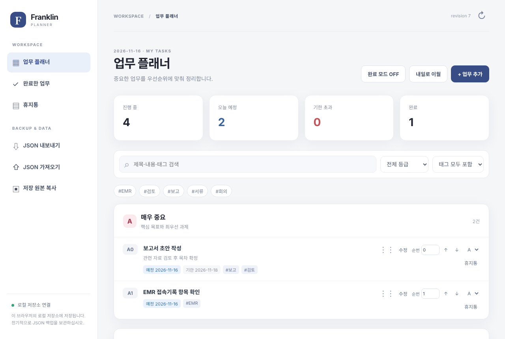
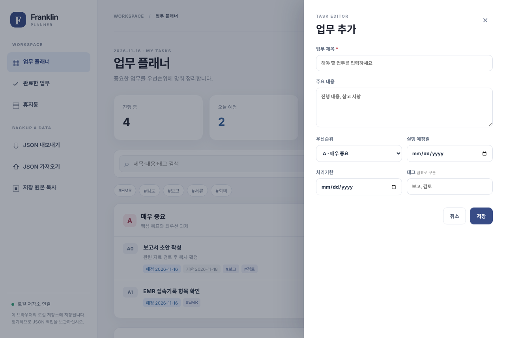
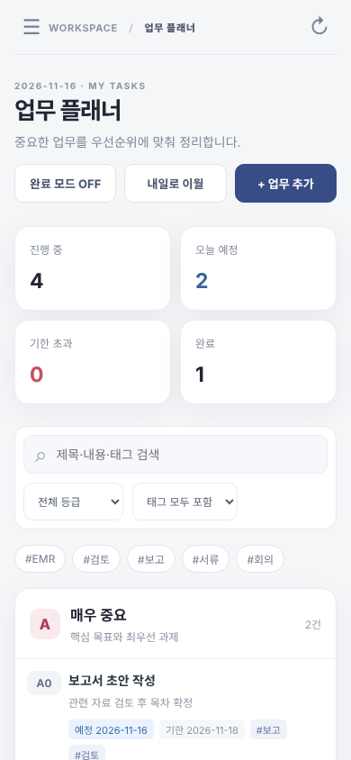
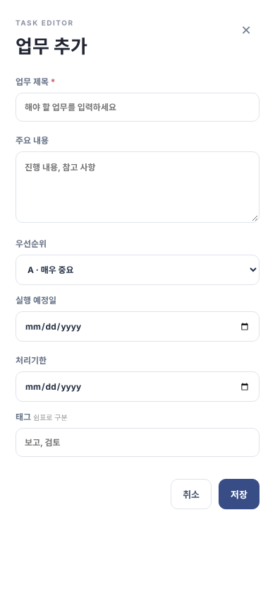

# Franklin Planner Web

Franklin A/B/C 우선순위 기반의 로컬 할 일 플래너입니다. 데이터 처리, 반응형 UI, 단일 HTML 빌드 및 Chromium 자동화 시험을 포함합니다. 현재 파일은 **자동화 검증을 통과한 배포 후보**이며, 실기기·브라우저별 추가 검증은 남아 있습니다.

## 개발용 화면 실행

Node.js 20 이상이 설치된 환경에서 저장소를 내려받아 다음과 같이 실행합니다.

```bash
npm run dev
```

브라우저에서 **http://127.0.0.1:4173/** 에 접속합니다. 개발 버전은 JavaScript ES 모듈로 구성돼 있으므로 소스의 `index.html`을 `file://`로 직접 여는 방식은 지원하지 않습니다. 더블클릭 실행에는 아래의 **빌드된 단일 HTML**을 사용합니다.

## 단일 HTML 빌드

```bash
npm run build
```

결과물은 `dist/franklin-planner.html`이며, CSS와 JavaScript를 포함한 단일 파일입니다. HTML을 더블클릭하여 `file://`로 실행할 수 있도록 제작했습니다. [GitHub Actions](https://github.com/muns5965/planner-web/actions)에서 최근 성공한 **Build and tests** 실행을 열고 **Artifacts → `franklin-planner-single-html`**에서 ZIP을 내려받을 수 있습니다(로그인이 필요할 수 있음). 브라우저별 저장 지속성은 반드시 별도 확인하십시오.

## 자동화 시험

```bash
npm run check
npm test
npm run test:browser
```

- **요구사항:** [docs/requirements-v3.4.md](docs/requirements-v3.4.md)
- **개발 지침:** [docs/development-guide.md](docs/development-guide.md)
- **5차 검증 보고:** [docs/phase5-verification.md](docs/phase5-verification.md)
- **1차:** `src/storage.js` 저장·복구, `src/validator.js` 검증
- **2차:** `src/tasks.js` 완료·순번·등급·태그
- **3차:** `src/dates-trash.js` 날짜·이월·휴지통
- **4차:** `src/editor.js` 등록·수정 데이터 변환, `src/ui.js` 화면 연결, `src/styles.css` 디자인, `index.html` 브라우저 진입
- **테스트:** `tests/*.test.js` 데이터 계층·편집·UI 구조·개발 서버 검사

## 현재 구현 범위

업무 추가/수정, A/B/C 등급 목록, 순번 숫자 입력·위아래 이동·마우스 드래그·터치 드래그(Chromium 에뮬레이션 검증), 검색·태그 필터, 완료 모드, 완료 취소, 이월 미리보기와 부분 취소, 휴지통·복원·영구 삭제, JSON 내보내기·가져오기, 손상 원본 내보내기·복구 모드 화면이 연결돼 있습니다. **v3.5의 태그 관리 창(이름 변경·병합·삭제)은 아직 구현되지 않았습니다.**

## 화면 안내

Franklin 플래너는 화면 폭에 따라 PC와 모바일 레이아웃이 달라지는 반응형 애플리케이션입니다. 데이터는 브라우저 프로필의 로컬 저장소에 보관됩니다. PC와 휴대전화, 다른 브라우저 사이에는 자동 동기화가 없습니다. `file://`의 저장 영역과 지속성은 브라우저·파일 위치에 따라 달라질 수 있으므로 다른 환경으로 옮길 때는 JSON 백업을 사용하십시오.

### 화면 목록

| 화면 | 들어가는 방법 | 설명 |
| --- | --- | --- |
| 업무 플래너 | 기본 화면 | A/B/C 등급별 목록, 요약 카드, 검색·태그·등급 필터 |
| 업무 편집 창 | **+ 업무 추가**, 업무 카드의 **수정** | 제목, 내용, 등급, 실행 예정일, 처리기한, 태그(쉼표 구분) 입력 |
| 완료한 업무 | 메뉴 → **완료한 업무** | 완료 업무와 **완료 취소** |
| 휴지통 | 메뉴 → **휴지통** | 삭제 업무의 **복원**, **영구 삭제**, **휴지통 비우기** |
| 완료 모드 | 상단 **완료 모드 OFF/ON** | ON일 때 각 업무의 **조작 영역(수정 버튼 근처)**에 완료 체크박스 표시 |
| 이월 | 상단 **내일로 이월** | 예정일이 오늘 이전 또는 오늘인 미완료 활성 업무만 내일로 이동. 예정일 없는 업무와 완료·휴지통 업무는 제외. 같은 세션에서 마지막 이월 취소 가능 |
| 데이터 메뉴 | 왼쪽 메뉴 하단 | JSON 내보내기·가져오기, 저장 원본 복사 |
| 복구 모드 | 저장값 손상 시 자동 전환 | 읽기 전용 경고와 일반 쓰기 차단, 원본 내보내기·복사, 검증된 백업 복구 및 초기화 |
| 태그 관리 (예정, v3.5) | 향후 메뉴 추가 | 태그 이름 변경·병합·삭제. **현재 미구현** |

### PC 화면

~~~text
┌──────────────────┬─────────────────────────────────────────────────────────┐
│ Franklin Planner │ 업무 플래너            [완료 모드] [내일로 이월] [+ 추가] │
│                  ├─────────────────────────────────────────────────────────┤
│ 업무 플래너       │ [진행 중] [오늘 예정] [기한 초과] [완료]                 │
│ 완료한 업무       ├─────────────────────────────────────────────────────────┤
│ 휴지통            │ [검색] [등급 선택] [태그 결합 방식] [필터 해제]          │
│                  │ #태그 #태그 ...                                       │
│ 데이터            ├─────────────────────────────────────────────────────────┤
│ · JSON 내보내기    │ A 매우 중요                                           │
│ · JSON 가져오기    │   A0 업무 제목 · 예정일 · 기한 · #태그                  │
│ · 원본 복사        │      수정 · 순번 입력 · ↑↓ · 등급 이동 · 휴지통          │
│                  │ B 중요                                               │
│ 저장소 상태       │ C 사소                                               │
└──────────────────┴─────────────────────────────────────────────────────────┘
~~~

**기본 화면**



**편집 화면**



왼쪽 메뉴로 화면을 바꾸고 JSON 백업을 관리합니다. 넓은 PC 화면의 요약 카드는 가로 4개로 표시됩니다. 업무 행에 순번(A0·A1 …), 예정일·처리기한·태그 및 수정·순번 입력·↑↓·등급 이동 버튼이 표시됩니다. **검색·태그·등급 필터가 적용되지 않은 상태에서만** 드래그 핸들(⋮⋮)로 등급 내 순서를 바꾸거나 다른 등급으로 옮길 수 있습니다.

### 모바일 화면

~~~text
┌────────────────────────────┐
│ ☰  업무 플래너          ↻  │
│ 날짜 · MY TASKS            │
│ 업무 플래너                 │
│ [완료 모드] [이월] [추가]   │
│ [진행 중]     [오늘 예정]   │
│ [기한 초과]   [완료]        │
│ [검색]                     │
│ [등급 선택] [태그 방식]    │
│ #태그 #태그 … (여러 줄)   │
│ A 매우 중요                │
│   A0 업무 제목             │
│      예정일 · 기한 · #태그  │
│      수정 · 순번 · ↑↓      │
│   A1 업무 제목 …           │
└────────────────────────────┘
~~~

**기본 화면**



**편집 화면**



상단 ☰ 버튼을 누르면 PC의 왼쪽 메뉴가 열립니다. 요약 카드는 2열로 바뀌고 업무 목록과 조작 영역은 화면 폭에 맞춰 세로로 쌓입니다. 태그는 가로 스크롤이 아닌 **여러 줄 줄바꿈**으로 표시됩니다. 터치 드래그는 Chromium 390×844 뷰포트 에뮬레이션에서 검증했으며 Android·iOS **실기기 시험은 아직 하지 않았습니다.**

### 검증 범위

Chromium 자동화 시험에서 단일 HTML의 `file://` 실행, 업무 등록·수정·저장·검색·이월·완료·휴지통, 위·아래 방향키 이동, 모바일 터치 에뮬레이션, JSON 내보내기·가져오기, 손상 데이터 복구와 두 탭 사이의 저장 변경 감지를 확인했습니다. 정확한 시험 건수와 실행 이력은 [5차 검증 보고서](docs/phase5-verification.md)에서 관리합니다.

실제 Android·iOS 기기, 다른 브라우저의 저장 지속성, 스크린리더 접근성과 잠금 미지원 환경에서의 동시 저장 안전성은 별도로 검증해야 합니다. 화면 캡처(`docs/screenshots/`)는 확인용 샘플 데이터로 만들었으므로 실제 데이터와 다를 수 있습니다.


**검증 범위 주의:** `npm run test:browser`는 Chromium에서 최종 단일 HTML을 `file://`로 열고 등록·검색·이월·완료·휴지통·새로고침 지속성 등을 확인합니다. 다른 브라우저의 저장소 지속성, 실제 Android/iOS 기기 및 스크린리더 사용성은 별도 검증이 필요합니다. 기존 2,496줄 HTML은 참고용이며 v1 데이터 호환이나 마이그레이션은 구현하지 않습니다.
